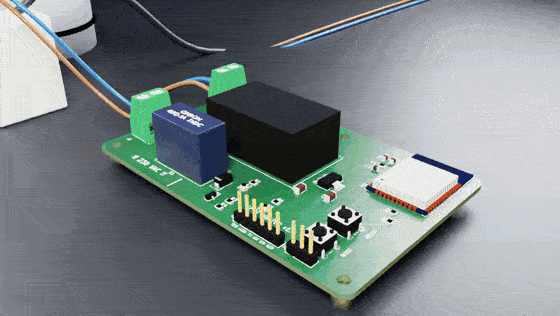

# Boili

**A spot-price controller for electric water heaters.** An ESP32 fetches Nord Pool electricity prices over WiFi and switches the heater's contactor coil on during the cheapest hours. The tank's own thermostat and over-temperature limiter stay in series with the heater element.

This is a concept project designed together with Claude (Opus 5.5). It covers the circuit and PCB in KiCad, an injection-moulded enclosure in FreeCAD, renders and animations in Blender, and a mock-up sales page at **[boili.frenzyfront.io](https://boili.frenzyfront.io)**.

> **Status: design files only.** The circuit has been checked in SPICE simulation, but the board and enclosure have not been built or tested on real hardware, there is no firmware yet, and nothing here is certified (CE / LVD / EMC). It is a mains-voltage device: wiring must be done by a qualified electrician, and Boili only switches a contactor coil. It never carries the heater current itself.

## Contents

| Folder | What |
|---|---|
| [`hardware/pcb`](hardware/pcb) | KiCad 9 project (rev 1.0): schematic, 2-layer PCB, Gerbers, drill and pick-and-place files ready for a PCB fab, plus BOM, schematic PDF and 3D render. ERC and DRC are clean. See its README for the pinout, wiring and design choices. |
| [`hardware/pcb/simulation`](hardware/pcb/simulation) | ngspice checks of the relay driver, boot behaviour, supply rails under WiFi bursts, and power-up sequencing, with worst-case part values. All pass. One open point: the AMS1117 with ceramic output capacitors (see that README). |
| [`hardware/enclosure`](hardware/enclosure) | Two-part PC/ABS (V-0) injection-moulded enclosure with the BOILI logo embossed: STEP files for the toolmaker, the FreeCAD document, the parametric `housing.py` source and a fit/clearance report. Target IP54. |
| [`website`](website) | The mock-up sales page (`index.html` + `media/`). It illustrates Opus 5.5 capabilities and is not a real product listing. |
| [`media/videos`](media/videos) | Explainer animation, PCB design speedrun, enclosure modelling speedrun, and the combined film. |
| [`media/gifs`](media/gifs) | GIF versions for social media (each under 5 MB). |
| [`tools`](tools) | The scripts and Blender files that produced the media: explainer animation, PCB speedrun renderer, enclosure speedrun, studio product shots and turntable. |

## Hardware at a glance

- **Board:** 96.5 × 62 mm, 2 layers. Input is 230 VAC → T1A fuse → varistor → HLK-PM01 (isolated 5 V) → 3.3 V regulator → ESP32-WROOM module.
- **Output:** Omron G5Q-1A relay, which drives the coil of a separate contactor rated for the heater (e.g. 3-pole 25 A, AC-1).
- **Isolation:** at least 6 mm clearance and creepage between mains and low-voltage copper, enforced with a custom DRC rule.
- **Extras:** status LED, BOOT/boost button, optional DS18B20 temperature-sensor header, programming header for the first flash, then updates over WiFi.
- **Enclosure:** 133 × 95 × 33 mm, wall-mounted, 2 × M16 cable glands, tongue-and-groove gasket.

## Notes on the tools

The scripts in `tools/` ran in a sandbox (KiCad 9, Blender 5 with Cycles, FreeCAD 1.0). They use that sandbox's absolute paths (`/work/...`), so adjust the paths before re-running them. The explainer and render scripts expect the PCB and enclosure exports from `hardware/`.

## Still to do

- Firmware: price fetch, cheapest-hours scheduling, a fallback schedule when WiFi or prices are unavailable, a boost button, and updates over WiFi.
- A first prototype build, plus tests of the relay, power supply and thermal behaviour.
- Pre-compliance testing before any real-world use.
