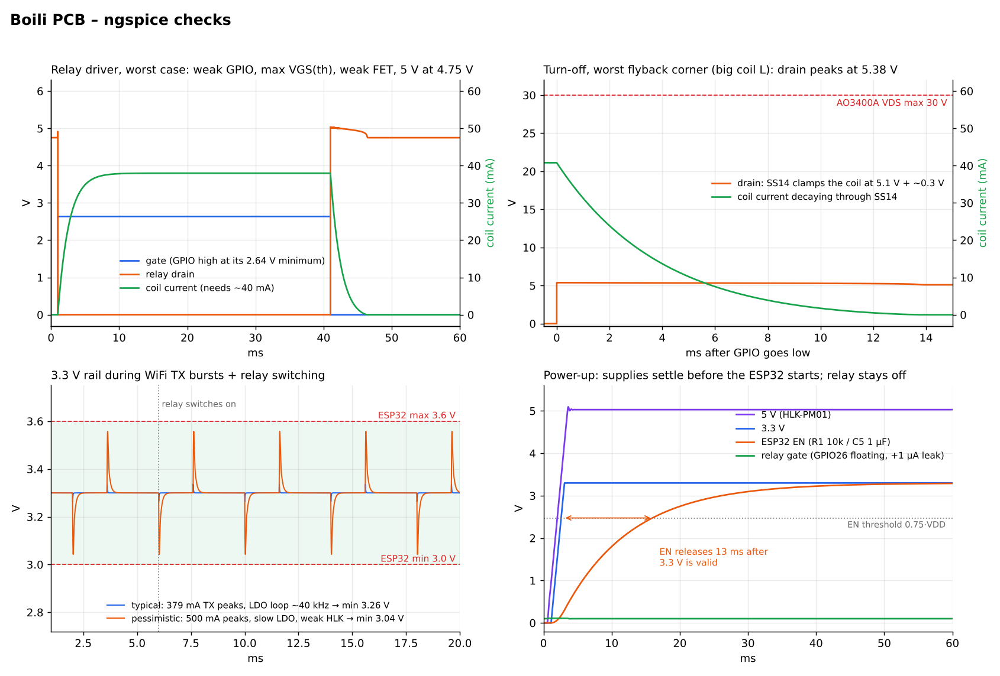

# Boili PCB: SPICE simulation

These ngspice checks answer one question before any board is built: does the circuit work across worst-case part values? The circuit topology comes from the KiCad netlist. The part values come from the manufacturers' datasheets, linked at the bottom.



## Results

| Check | Result | Limit | Verdict |
|---|---|---|---|
| Relay coil voltage, worst case (GPIO at its 2.64 V minimum, MOSFET VGS(th) at its 1.45 V maximum, weak MOSFET, 5 V sagging to 4.75 V) | 4.75 V | must operate ≤ 3.75 V (75 %) | ✅ |
| MOSFET voltage drop when on | 2 mV (≈ 0.1 mW of heat) | | ✅ |
| Drain spike at turn-off | 5.38 V at worst | AO3400A VDS max 30 V | ✅ SS14 clamps it |
| Reverse voltage on the red LED during that spike | ≈ 0.3 V | 5 V | ✅ |
| Relay release time (coil inductance unknown, swept 50–500 mH) | ≈ 1–10 ms | | ✅ irrelevant for a contactor coil |
| Relay during boot: GPIO26 floating (no internal pull at reset) with ±1 µA leakage | gate 0.1 V, relay off | VGS(th) min 0.65 V | ✅ about 6 µA would be needed to turn it on |
| 3.3 V minimum during WiFi TX bursts, typical case | 3.26 V | ESP32 VDD 3.0–3.6 V | ✅ |
| 3.3 V during WiFi TX bursts, pessimistic case (500 mA bursts, slow regulator, weak 5 V module) | 3.04 V min / 3.56 V max | 3.0–3.6 V | ⚠️ in spec, small margin |
| 5 V minimum (regulator input headroom) | ≥ 4.6 V, leaving ≥ 1.3 V over 3.3 V | AMS1117 dropout ≈ 1.1 V | ✅ |
| Load on the 5 V module | 0.22–0.27 A average, 0.5–0.86 A peaks | 0.6 A continuous, 1 A short-term | ✅ |
| Power-up sequencing | 3.3 V is valid at 2.9 ms; EN releases 13 ms later | | ✅ |

## What the simulation can't tell you

The **AMS1117 datasheet asks for a 22 µF solid tantalum output capacitor**. This board uses ceramic capacitors (C2, C3), and some AMS1117 parts can oscillate with ceramics. There is no vendor simulation model, so the regulator here is a generic behavioural model whose loop speed is swept. That shows the rails are fine *if it is stable*, but it can't prove that it won't oscillate.

To settle this on a real board, scope the 3.3 V rail during WiFi transmit. If it oscillates, there are two easy fixes:
- Use a tantalum capacitor for C2.
- Use a 1117-compatible regulator that is specified as stable with ceramics, for example ST's LDL1117. Check its pinout first.

## Model notes

- **AO3400A:** Level-1 model fitted to RDS(on) at 4.5 V and 2.5 V. Capacitances and gate resistance come from the datasheet. VGS(th) is swept from 0.65 to 1.45 V.
- **SS14 and the red LED:** generic diode models.
- **G5Q-1A coil:** 125 Ω / 40 mA, must operate ≤ 75 %, must release ≥ 5 % (Omron). The inductance isn't published, so it's swept.
- **HLK-PM01:** 5.0 V ± 0.1 V with about 0.1 V droop at 0.6 A. Its internal output capacitance and loop speed aren't published, so they're swept.
- **ESP32 load:** 80 mA base plus TX bursts of 379 mA, the datasheet peak for 802.11b at 19.5 dBm, and 500 mA as a worst case.
- **Capacitors:** ceramic capacitances are derated for DC bias.

## Run it

Requires ngspice (tested with v42), Python 3, numpy and matplotlib.

```bash
python3 run_sims.py      # writes decks, logs and waveforms to out/, measurements to results.json
python3 plot_results.py  # boili_spice_results.png
```

## Sources

- [Omron G5Q datasheet](https://components.omron.com/us-en/system/files/2025-06/datasheet_pdf/J155-E1.pdf)
- [AO3400A datasheet](https://www.aosmd.com/res/datasheets/AO3400A.pdf)
- [ESP32-WROOM-32E datasheet](https://documentation.espressif.com/esp32-wroom-32e_esp32-wroom-32ue_datasheet_en.pdf)
- [ESP32 pin list, reset states](https://www.waveshare.com/w/upload/8/86/Esp32_chip_pin_list_en.pdf)
- [AMS1117 datasheet](https://files.waveshare.com/upload/b/b8/AMS1117-datasheet.pdf)
- [HLK-PM01 review by lygte-info](https://lygte-info.dk/review/Power%20Mains%20to%205V%200.6A%20Hi-Link%20HLK-PM01%20UK.html)
